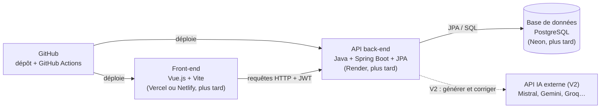

# Cahier des charges — Mémo+

> **Le cours est fini, pas ce que tu en as appris.**
> Projet personnel — EIJ · Version du 14 octobre 2026

## Sommaire

1. [Contexte et problème](#1-contexte-et-problème)
2. [Rôle et objectifs de l'application](#2-rôle-et-objectifs-de-lapplication)
3. [Public cible](#3-public-cible)
4. [Fonctionnalités](#4-fonctionnalités)
5. [Parcours utilisateur type](#5-parcours-utilisateur-type)
6. [Exigences non fonctionnelles](#6-exigences-non-fonctionnelles)
7. [Architecture technique et outils](#7-architecture-technique-et-outils)
8. [Modèle de données](#8-modèle-de-données)
9. [Algorithme de répétition espacée](#9-algorithme-de-répétition-espacée)
10. [Organisation GitHub, CI/CD et déploiement](#10-organisation-github-cicd-et-déploiement)
11. [Planning par étapes](#11-planning-par-étapes)
12. [Risques et critères de réussite](#12-risques-et-critères-de-réussite)

## 1. Contexte et problème

Une fois un cours validé, l'effort s'arrête et l'oubli commence : quelques semaines plus tard, l'essentiel a disparu.

Exemple concret : en 4e année d'école d'ingénieurs, on ne sait plus répondre sur les cours de 3e année, ni sur un langage comme Python étudié il y a plusieurs années. Pour s'y remettre, on reprend tout le cours depuis le début, on cherche le PDF, on relit des sites entiers.

Le problème touche tout le monde : étudiants, lycéens après le bac, collégiens, dans toutes les matières (programmation, maths, physique, histoire-géographie, langues).

Pourquoi les outils actuels ne suffisent pas :

- **Les chatbots (LLM)** répondent à ta place, mais en entretien, en examen ou au travail, c'est toi qui dois savoir.
- **Les applis de révision** sont surtout pensées pour préparer un examen, pas pour entretenir les connaissances après.
- **Relire ses cours** est passif et long : on a l'impression de savoir, sans pouvoir le restituer.

## 2. Rôle et objectifs de l'application

**Rôle : garder tes connaissances vivantes dans ta tête, et quand elles se sont effacées, te les faire revenir vite, sans tout recommencer.**

Nom de l'application : **Mémo+** (dépôt GitHub : `memo-plus`).

L'application remplit trois missions :

1. **Entretenir** ce que tu sais encore : 5 à 10 minutes de questions par jour sur tes anciennes matières, de plus en plus espacées dans le temps (répétition espacée). Tu réponds de mémoire, sans relire (rappel actif).
2. **Mesurer** ce qu'il te reste vraiment : un test de diagnostic par matière produit une carte des notions (acquis / fragile / oublié).
3. **Réactiver** uniquement ce qui manque : un parcours ciblé sur les notions oubliées, au lieu de reprendre tout le cours.

Ce que l'application ne fait **pas** : répondre à ta place. L'IA, si elle est ajoutée plus tard, sert à générer et corriger des questions, jamais à te dispenser de savoir.

## 3. Public cible

Cible principale : les étudiants du supérieur. L'application sert aussi aux collégiens et lycéens ; le primaire n'est pas visé. Les enseignants l'utilisent comme tout le monde, pour entretenir leurs propres connaissances, sans rôle à part.

| Persona | Situation | Besoin principal |
| --- | --- | --- |
| Étudiante en école d'ingénieurs (ING4) | A validé Python et le C il y a plusieurs années, ne s'en souvient plus | Réactiver un langage avant un entretien d'alternance |
| Étudiant en licence | A oublié les maths et la physique du lycée | Garder les bases utiles pour la suite |
| Lycéen | Passe d'un chapitre à l'autre, oublie ceux des années précédentes | Entretenir sans repasser le cours entier |
| Collégien | Oublie l'histoire-géo ou les maths de l'an dernier | Garder les bases d'une année sur l'autre |
| Enseignant | A oublié des notions en dehors de ce qu'il enseigne | Les entretenir, comme n'importe quel utilisateur |
| Professionnel en reconversion | A besoin de notions apprises il y a longtemps | Faire un point rapide sur ce qui reste |

## 4. Fonctionnalités

La V1 fonctionne entièrement sans IA : questions saisies à la main, algorithme d'espacement codé soi-même.

| Réf. | Fonctionnalité | Description | Priorité |
| --- | --- | --- | --- |
| F1 | Compte utilisateur | Inscription, connexion, déconnexion (email + mot de passe) | V1 — indispensable |
| F2 | Matières et notions | Créer une matière (ex. Python), la découper en notions (variables, boucles, listes, classes…) | V1 — indispensable |
| F3 | Questions | Créer, modifier, supprimer des questions rattachées à une notion | V1 — indispensable |
| F4 | Types de questions | Question / réponse libre (auto-évaluation), QCM, « que va afficher ce code ? » | V1 — indispensable |
| F5 | Session du jour | 5 à 10 min de questions dues, choisies par l'algorithme d'espacement | V1 — indispensable |
| F6 | Auto-évaluation | Après chaque réponse : Oublié / Difficile / Bien / Facile, qui règle la prochaine révision | V1 — indispensable |
| F7 | Diagnostic | Test rapide sur une matière pour savoir ce qui reste | V1 — important |
| F8 | Carte des connaissances | État de chaque notion : acquis, fragile, oublié | V1 — important |
| F9 | Parcours de réactivation | Plan sur N jours ciblé sur les notions oubliées (ex. « Python en 5 jours ») | V1 — important |
| F10 | Import / export | Importer et exporter des questions en JSON ou CSV | V1 — souhaitable |
| F11 | Decks partagés | Publier les questions d'une matière pour d'autres utilisateurs | V2 |
| F12 | Génération par IA | Générer des questions à partir d'un PDF de cours via une API externe | V2 |
| F13 | Correction par IA | Évaluer une réponse rédigée librement | V2 |
| F14 | Nouveaux types | Remise en ordre chronologique, carte géographique, maths à valeurs variables, code exécuté | V2 / V3 |
| F15 | Notifications et application mobile | Rappel quotidien, version mobile | V3 |

Hors périmètre de la V1 : IA, mobile, partage public, paiement.

## 5. Parcours utilisateur type

Scénario : un entretien d'alternance dans une semaine, avec des questions sur Python, étudié il y a plusieurs années.

1. L'utilisatrice ouvre l'appli et choisit la matière « Python ».
2. Elle lance le **diagnostic** : 15 à 20 questions, environ 10 minutes, réparties sur toutes les notions.
3. L'appli affiche la **carte des connaissances** : variables et boucles acquises, listes et dictionnaires fragiles, classes et exceptions oubliées.
4. Elle demande un **parcours de réactivation sur 5 jours**. L'appli ne retient que les notions fragiles et oubliées.
5. Chaque jour, une **session** de 10 à 15 minutes : rappel court de la notion, puis questions.
6. Le jour de l'entretien, les notions sont revenues. Elles passent ensuite en **entretien long terme** : quelques questions de temps en temps pendant des mois.

Usage quotidien hors scénario : chaque jour, l'appli propose la session du jour, toutes matières confondues, avec les questions arrivées à échéance.

## 6. Exigences non fonctionnelles

| Exigence | Attendu |
| --- | --- |
| Simplicité | Une session se lance en 1 clic depuis l'accueil ; interface lisible par un collégien |
| Responsive | Utilisable sur ordinateur et téléphone (navigateur) |
| Performance | Pages chargées en moins de 2 s ; réponse de l'API en moins de 300 ms |
| Sécurité | Mots de passe hachés (bcrypt), authentification par jeton (JWT), validation de toutes les entrées, secrets dans `.env` jamais publiés |
| Données personnelles | Chaque utilisateur ne voit que ses données ; suppression du compte possible (RGPD) |
| Qualité du code | Tests automatisés sur la logique métier (JUnit), code formaté, chaque pull request relue avant fusion |
| Coût | 0 € en V1 : hébergements gratuits uniquement |
| Langue | Interface en français en V1, code et commits en anglais |

## 7. Architecture technique et outils

Application web en trois parties : un front-end Vue.js, une API Java Spring Boot, une base PostgreSQL. La stack s'appuie sur ce qui est déjà maîtrisé (Java, SQL, Docker, GitHub Actions, Swagger) et n'ajoute que l'indispensable à apprendre : Vue.js, Spring Boot, JPA et Spring Security.



Le navigateur ne parle qu'à l'API ; la base de données et, plus tard, l'IA ne sont jamais exposées directement.

| Couche | Outil | Rôle | Statut |
| --- | --- | --- | --- |
| Front-end | Vue.js 3 + Vite (JavaScript) | Interface : sessions, carte, gestion des questions | À apprendre — plus simple que React ou Angular, demandé avec Java ; Vite est créé automatiquement avec Vue |
| Style | CSS classique | Mise en forme, responsive | Déjà maîtrisé |
| Appels à l'API | fetch (natif du navigateur) | Communiquer avec le back-end | Rien à installer |
| Back-end | Java + Spring Boot, build Maven | API REST, logique métier, algorithme d'espacement | À apprendre — suite logique de Javalin, très demandé en alternance Java |
| Accès aux données | Spring Data JPA (Hibernate) | Lire et écrire en base avec des objets Java | À apprendre — remplace le JDBC écrit à la main |
| Validation | Bean Validation (@NotNull, @Size…) | Vérifier les données reçues | Intégré à Spring |
| Base de données | PostgreSQL | Stocker utilisateurs, matières, questions, révisions | SQL déjà maîtrisé |
| Authentification | Spring Security + JWT, mots de passe hachés BCrypt | Inscription, connexion, routes protégées | À apprendre — indispensable |
| Documentation de l'API | springdoc-openapi (Swagger UI) | Tester et documenter l'API | Swagger déjà utilisé |
| Tests | JUnit 5, Mockito, MockMvc | Fiabilité de la logique et de l'API | Standard Java |
| Conteneurs | Docker + Docker Compose | Lancer PostgreSQL (et l'API) en local d'une commande | Déjà maîtrisé |
| CI/CD | GitHub Actions | Build Maven et tests à chaque push | Déjà utilisé |
| Hébergement (plus tard) | Vercel ou Netlify (front), Render (API en Docker), Neon (PostgreSQL) | Mise en ligne si l'appli fonctionne bien | Offres gratuites, conditions à vérifier |
| IA (V2) | API externe : Mistral, Gemini, Groq ou autre | Générer et corriger des questions | Appel depuis le back-end uniquement |

Outils de travail : IntelliJ IDEA (back-end), VS Code (front-end), Git, GitHub, Postman ou Bruno (tester l'API), Figma ou papier pour les maquettes.

L'appel à l'IA en V2 passe toujours par le back-end : la clé d'API reste dans le `.env` du serveur, jamais dans le front ni sur GitHub.

## 8. Modèle de données

Six tables suffisent pour la V1 : un utilisateur possède des matières, une matière contient des notions, une notion contient des questions, et chaque question a un état de révision par utilisateur.

| Table | Champs principaux | Relation |
| --- | --- | --- |
| User | id, email, passwordHash, name, createdAt | possède plusieurs Subject |
| Subject | id, userId, name (ex. Python), description, createdAt | contient plusieurs Topic |
| Topic | id, subjectId, name (ex. Listes), order | contient plusieurs Question |
| Question | id, topicId, type (FREE, MCQ, CODE_OUTPUT), prompt, answer, choices (JSON), explanation | a un ReviewState par utilisateur |
| ReviewState | id, userId, questionId, easeFactor, interval (jours), repetitions, dueDate, lastReviewedAt | une ligne par question et par utilisateur |
| ReviewLog | id, userId, questionId, grade (0–3), reviewedAt, durationMs | historique, sert aux statistiques et à la carte |

L'état d'une notion sur la carte (acquis / fragile / oublié) se calcule à partir des ReviewState et ReviewLog de ses questions : pas besoin de le stocker.

## 9. Algorithme de répétition espacée

La V1 utilise une version simplifiée de SM-2, l'algorithme historique d'Anki : plus tu réussis une question, plus elle revient tard.

Après chaque réponse, l'utilisateur choisit une note, convertie en score q :

| Bouton | Score q | Effet |
| --- | --- | --- |
| Oublié | 1 | Retour à zéro : la question revient le lendemain |
| Difficile | 3 | L'intervalle augmente peu |
| Bien | 4 | L'intervalle augmente normalement |
| Facile | 5 | L'intervalle augmente fortement |

Calcul du prochain intervalle (en jours) :

1. 1re réussite : 1 jour ; 2e réussite : 6 jours ; ensuite, intervalle précédent × facteur de facilité (EF).
2. EF démarre à 2,5 et s'ajuste à chaque réponse, sans descendre sous 1,3 :

```math
EF' = EF + \left(0{,}1 - (5 - q)\,\big(0{,}08 + (5 - q) \times 0{,}02\big)\right)
```

3. Date de prochaine révision = aujourd'hui + intervalle.

Exemple : une question toujours notée « Bien » revient après 1, 6, 15, 38 puis 95 jours environ. En quelques mois, elle ne demande plus qu'une révision par trimestre.

État d'une notion sur la carte (règle de départ, à ajuster à l'usage) :

- **Acquis** : la majorité de ses questions ont un intervalle d'au moins 21 jours et une dernière note supérieure ou égale à « Bien ».
- **Oublié** : la majorité ont été notées « Oublié » à la dernière révision ou au diagnostic.
- **Fragile** : tous les autres cas.

Amélioration possible en V2 : FSRS, un algorithme plus récent et plus précis, désormais proposé dans Anki.

## 10. Organisation GitHub, CI/CD et déploiement

Un seul dépôt public (monorepo) contient le front, le back et la documentation : plus simple à suivre seul et plus lisible pour un recruteur.

Structure du dépôt :

```
memo-plus/
├── frontend/            # interface Vue.js + Vite
├── backend/             # API Java Spring Boot (Maven)
│   └── src/main/java/   # contrôleurs, services, entités JPA
├── docs/                # cahier des charges, maquettes, captures
├── .github/workflows/   # CI GitHub Actions
├── docker-compose.yml   # PostgreSQL (+ API) en local
├── .env.example         # variables à remplir, sans valeurs secrètes
├── .gitignore           # exclut .env, node_modules, target
├── LICENSE              # MIT
└── README.md
```

Bonnes pratiques :

- **Branches** : `main` toujours fonctionnelle ; une branche par fonctionnalité (`feat/session-du-jour`, `fix/login`), fusionnée par pull request.
- **Commits** : messages courts et explicites, format Conventional Commits (`feat: add daily session`, `fix: ...`).
- **Suivi** : une issue par fonctionnalité (F1, F2…), regroupées dans un tableau GitHub Projects (À faire / En cours / Fait).
- **CI** : à chaque push et pull request, GitHub Actions lance le lint, les tests et le build.
- **README** : pitch, capture d'écran, lien vers la démo en ligne, stack technique, instructions d'installation, feuille de route.
- **Secrets** : jamais de clé, de mot de passe ou d'URL de base de données dans le code ; uniquement `.env` local et variables d'environnement de l'hébergeur.

Déploiement, plus tard et si l'appli fonctionne bien : le front sur Vercel ou Netlify, l'API sur Render, la base sur Neon, avec déploiement automatique depuis `main`.

## 11. Planning par étapes

La V1 se construit en 7 étapes, chacune livrant quelque chose qui fonctionne. Durées indicatives pour un projet mené à côté des cours.

1. **Mise en place** (1 semaine) : nom du projet, dépôt GitHub, README, licence, structure des dossiers, Docker Compose avec PostgreSQL, CI minimale.
2. **Back-end de base** (2 semaines) : prise en main de Spring Boot, entités JPA, API REST CRUD matières / notions / questions, tests JUnit.
3. **Authentification** (1 semaine) : Spring Security + JWT : inscription, connexion, routes protégées.
4. **Front-end de base** (2 semaines) : prise en main de Vue.js, pages connexion, matières, création de questions.
5. **Moteur de révision** (2 semaines) : algorithme SM-2 testé, session du jour, boutons d'auto-évaluation.
6. **Diagnostic, carte et réactivation** (2 semaines) : F7, F8, F9.
7. **Mise en ligne** (1 semaine) : déploiement, import JSON, 50 questions Python de départ, README final avec captures.

Ensuite :

- **V2** : decks partagés, génération et correction par IA, nouveaux types de questions, algorithme FSRS.
- **V3** : notifications, application mobile.

## 12. Risques et critères de réussite

| Risque | Conséquence | Parade |
| --- | --- | --- |
| Projet trop ambitieux | Jamais fini | S'en tenir aux fonctionnalités V1, tout le reste attend |
| Manque de temps (cours, alternance) | Abandon en cours de route | Étapes courtes qui fonctionnent chacune ; commits réguliers même petits |
| Écrire les questions prend du temps | Appli vide, peu utilisée | Commencer par une seule matière (Python) ; import JSON ; IA en V2 |
| Offres gratuites d'hébergement qui changent | Appli hors ligne | Docker pour pouvoir déménager facilement |
| Fuite de secrets sur GitHub | Compte ou base compromis | `.env` dans `.gitignore` dès le premier commit |

La V1 est réussie quand :

- [ ] L'appli est en ligne et accessible par un lien
- [ ] On peut créer un compte, une matière, des notions et des questions
- [ ] La session du jour fonctionne avec l'algorithme d'espacement testé
- [ ] Le diagnostic produit une carte des connaissances
- [ ] Un parcours de réactivation Python est utilisable de bout en bout
- [ ] La CI passe sur `main` et le README présente le projet avec captures
- [ ] Je l'utilise moi-même au moins 3 semaines pour réviser Python
